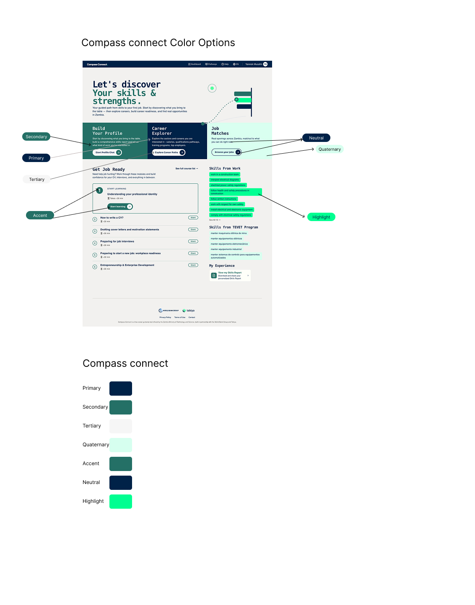

# Compass Connect Customisation Guide

This guide documents which parts of a Compass Connect deployment can be customised.
All options are defined in [`config/default.json`](../../config/default.json), which is the source of truth for available settings.

The configuration is organized into the following sections:

- **branding** — Application name, logos, colors, illustrations, and SEO metadata
- **auth** — Authentication behavior
- **cv** — CV feature availability
- **modules** — Which modules the deployment offers
- **strings** — Interface text overrides
- **skillsReport** — Skills report branding, formats, and content
- **i18n** — Language and locale settings
- **analytics** — Google Analytics 4 and Google Tag Manager integration
- **faq** — Tutorial video URL
- **sensitiveData** — User data collection fields

Only options exposed in these sections are customizable. Core application logic, workflows, and page layouts are fixed.

## Where Settings Go

Each setting has a name in `config/default.json` (for example `modules.disabled`) and an environment variable (for
example `FRONTEND_DISABLED_MODULES`). Which one you edit depends on how you run Compass Connect:

- **With Docker (recommended):** set the environment variables in the `.env` file at the root of the repository, the
  one the [getting-started guide](../getting-started/README.md#docker-setup) creates from `.env.example`. The
  [environment variable reference](#environment-variable-reference) lists the variable of each setting.
- **Without Docker (local development):** write the settings in a copy of `config/default.json` and copy them into the
  backend and frontend with `config/inject-config.py`.

See [Applying Changes](#applying-changes) for the steps.

## App Name & Tab Title

- `branding.appName` — name displayed throughout the application
- `branding.country` — country name shown in dashboard (e.g. "opportunities in Zambia"); defaults to "your country" when unset
- `branding.browserTabTitle` — text shown in the browser tab

## SEO Metadata

- `branding.metaDescription` — search engine description
- `branding.seo.name` — site name for search results
- `branding.seo.url` — public application URL
- `branding.seo.image` — image used for social sharing
- `branding.seo.description` — detailed SEO description

## Logos & Icons

Place assets in `frontend-new/public/` and reference them as `/filename.ext`,
or use a full URL to an externally hosted asset.

- `branding.assets.logo` — main logo
- `branding.assets.darkLogo` — logo variant used on light backgrounds
- `branding.assets.favicon` — browser tab icon
- `branding.assets.appIcon` — app icon (mobile / PWA)
- `branding.assets.chatAvatar` — AI assistant avatar shown in the chat interface

`branding.partnerLogos` is a list of partner logos shown in the footer.
Each entry takes `src`, `alt`, and optional `width` / `height`.

## Illustrations

`branding.illustrations` controls the images shown across key pages.
Each value can be a plain path (`"/image.ext"`) or an object with `src`, `width`, and `height`
when you also want to control the display size.

- `loginHero` — large hero image on the login page
- `loginFeature1`, `loginFeature2`, `loginFeature3` — three feature images on the login page
- `homeHero` — hero image on the home page
- `homeHeroIllustrationPosition` — `center` or `edge`, controls the hero alignment
- `careerReadinessHero` — hero image on the career readiness page
- `authShapesBackground` — decorative background pattern on auth pages
- `dashboardShapesBackground` — decorative background pattern on the dashboard

## Colors

The application has seven brand colors. Each controls a specific region of the UI.



All color keys live under `branding.theme` in the config file.
colors are defined as space-separated RGB values, for example `"0 255 145"`.
This format lets the application generate transparency variants automatically.

- `brand-primary` — primary action buttons and key interactive elements
- `brand-secondary` — section headers and feature cards
- `brand-tertiary` — subtle backgrounds and lower-emphasis areas
- `brand-quaternary` — specific card backgrounds
- `brand-accent` — tag chips and inline highlights
- `brand-neutral` — navigation bar
- `brand-highlight` — skill tags and programme chips

Each color supports four variants by appending a suffix:
`(none)` for the main value, `-light`, `-dark`, and `-contrast-text`.
If only the main value is set the others are derived automatically.

After changing colors, verify text contrast meets WCAG AA
(4.5 : 1 for body text, 3 : 1 for large text) using the
[WebAIM Contrast Checker](https://webaim.org/resources/contrastchecker/).

## Languages & Translations

### Enabling Languages

- `i18n.ui.defaultLocale` — language that loads by default
- `i18n.ui.supportedLocales` — list of languages shown in the language switcher
- `i18n.conversation.default_locale` — default language for the AI conversation
- `i18n.conversation.available_locales` — languages available for the AI conversation

### Changing Interface Texts

`strings` (`FRONTEND_STRINGS_OVERRIDES`) replaces individual interface texts for this deployment, per language,
without changing the shared translation files. It is optional: texts that are not listed keep their built-in translation.

```json
"strings": {
  "es-ES": {
    "home.hero.headline1": "Descubramos",
    "home.hero.body": "Conversa con {{appName}} y obtén tu informe de habilidades."
  }
}
```

- Each key is the path of the text in `frontend-new/src/i18n/locales/<locale>/translation.json`, joined with dots.
  For example, `home.hero.headline1` is `"headline1"` inside `"hero"` inside `"home"`. To find a key, search that file
  for the text you see on the page.
- The locale must be one of the supported locales (for example `es-ES`, `en-US`). A text for `es-ES` also applies when
  the browser asks for plain `es`, as the built-in translation does.
- `{{appName}}` and `{{country}}` are filled in as in the built-in texts (`branding.appName`, `branding.country`).
- Overrides that name no existing text (usually a typo), or are not text, are ignored with a warning in the browser
  console.

This covers the interface only: what the AI says in the conversation is not changed. An override replaces the whole
text, so when the built-in text is reworded in a later version, the override keeps the deployment's wording until
it is updated.

### Adding or Translating a Language

To add a new language or update existing translations, see the [Language Guide](../../add-a-new-language.md).

## Localizing for Your National Context

Beyond UI translations, Compass Connect can be adapted to fit your program's labor market realities and educational context. Each major module has configurable options and specific information requirements from the implementing team.

### Build Your Profile (Skills Elicitation Agent)

The core Compass agent can be optimized for efficient, context-relevant skills elicitation:

- **Skills taxonomy** — Choose or build a localized taxonomy that best fits your labor market realities (e.g., the KESCO taxonomy in Kenya, national occupation standards in Zambia).
- **Employment types** — Configure and sequence the types of work/employment most relevant to ask your users.
- **Probing depth** — Adapt the extent to which the agent probes into tasks under a work experience.
- **Job preferences** — Turn on/off asking about job preferences.
- **CV upload & skills report** — Turn on/off CV upload and change skills report formatting options (see [CV Upload](#cv-upload) and [Skills Report](#skills-report)).

> **Information required**: National occupational taxonomy or standards to enable a localized skills taxonomy behind the agent.
>
> **Effort**: High — taxonomy localization requires dedicated research capacity.

### Career Readiness Learning Modules

The Job Readiness Learning Modules are designed for easy content and tutoring method adaptation:

- **Tutoring style** — Adapt system prompts to change tutoring styles (default is Scaffolded Socratic tutoring).
- **Module progression** — Turn on/off sequential module progression dependent on "passing".
- **Quizzes** — Turn on/off quiz-based end-of-module assessments.
- **Open support mode** — Turn on/off "Open support mode" post quiz completion.
- **Module content** — Change or add topics and lesson plans to the module list.

> **Information required**: Existing educational materials and curricula on practical or soft skills training for job readiness (e.g., in Zambia, TEVETA's Entrepreneurship course curriculum was used as content for one module).
>
> **Effort**: Low — module content is easily inserted once material is available.

### Career Explorer

The Career Explorer is optimized for adapting sectoral background content and what to spotlight:

- **Sectors** — Remove or change the sectors a user can explore, for more or less specialized guidance.
- **Priority sectors** — Choose which national priority sectors the agent nudges users to explore.
- **Sectoral data** — Ground the agent's context in nationally sourced and vetted sectoral data, training pathways, and career options.
- **Question guardrails** — Guardrail the types of user questions the agent should attempt to answer.
- **General knowledge** — Turn on/off whether the LLM uses general knowledge to answer questions.

> **Information required**: Labor market background documents (key economic sectors, national priorities, job concentration trends); national labor force survey microdata and reports; program offerings (training institutions and pathways available to users).
>
> **Effort**: Medium — may require dedicated research capacity depending on the quality of materials available.

### Job Matching

The Job Matching pipeline scrapes, classifies, and surfaces jobs to users:

- **Job sources** — Choose which job boards and aggregation sources to scrape from (e.g., gozambia.com in Zambia, or jobs provided directly by the implementing partner in Argentina).
- **Informal sources** — Explore sourcing jobs from non-traditional, informal sources such as social media channels (high development overhead).
- **Job detail columns** — Hide or unhide columns on job details visible to users.

> **Information required**: Preferred job boards and aggregation sources.
>
> **Effort**: Low.

### User Onboarding & Platform Access

- **Data collection fields** — Configure which user information fields the project wants to collect (see [Data Collection Fields](#data-collection-fields)).
- **Administrative integration** — Optionally integrate with a pre-existing administrative database of users.
- **FAQ and tutorials** — Provide non-technical onboarding guides and video tutorials accessible on the platform/FAQ (see [FAQ Video](#faq-video)).

> **Effort**: Low to medium — mostly configurable changes unless integration with an admin platform is required.

### Localization Effort Summary

| Module | Information required from implementing team | Effort |
|---|---|---|
| User Onboarding & Access | User data fields to collect; optional pre-existing admin user database; onboarding guides and tutorial videos | Low–Medium |
| Build Your Profile | National occupational taxonomy or standards for localized skills taxonomy | High |
| Career Readiness Modules | Existing curricula on job-readiness and soft skills training | Low |
| Career Explorer | Labor market background docs, labor force surveys, program and institution listings | Medium |
| Job Matching | Preferred job boards and scraping sources | Low |

## Authentication

- `auth.disableLoginCode` — remove the login code requirement
- `auth.disableRegistrationCode` — remove the registration code requirement
- `auth.disableRegistration` — make the app login-only (hides the register flow entirely)
- `auth.disableSocialAuth` — hide social login options such as Google sign-in

## Legal Documents

Legal documents are matched to the deployment automatically using `branding.appName` (case-insensitive).

To add documents for a new deployment:

1. Add two Markdown files to `frontend-new/src/legal/documents/`:
   - `privacy-policy-{product-slug}.md`
   - `terms-of-use-{product-slug}.md`
2. Register them in `frontend-new/src/legal/legalDocumentLoader.ts` under `documentsByProductName`.

If no match is found the app falls back to the default documents.

## Features

### CV Upload

`cv.enabled` controls whether CV functionality is available in the application.
Set to `true` to enable or `false` to disable.
When disabled, all CV-related UI elements are hidden and CV APIs are not registered.

### Modules

`modules.disabled` (`FRONTEND_DISABLED_MODULES`) lists the modules this deployment does not offer. It is optional:
when it is missing or empty, every module is available.

| Id | Module |
|---|---|
| `skills_discovery` | Build your profile (the skills conversation) |
| `career_explorer` | Career Explorer |
| `job_readiness` | Career Readiness learning modules |
| `knowledge_hub` | Knowledge Hub (career pathways) |
| `job_matching` | Job Matching |
| `faq` | Help (the FAQ page, with the tutorial video) |

```json
"modules": { "disabled": ["career_explorer", "job_matching"] }
```

A disabled module is hidden everywhere in the frontend: its pages are removed (a direct link shows "not found"),
and so are the links to it, such as the home page cards, the navigation bar, the help button of the sign-in pages and
the "Continue with ..." suggestion at the end of another module. Hiding `faq` leaves users without in-app help, also
before they sign in. A hand-off link whose action lands in a disabled module takes the user to the home page.

This only hides the module in the frontend; its backend endpoints stay available. Unknown ids are ignored with a
warning in the browser console.

Hiding modules does not change texts that mention them, such as the home page introduction. Review those and change
them with [`strings`](#changing-interface-texts); [Example: a Skills-Only Deployment](#example-a-skills-only-deployment)
shows which ones.

`modules.hideProgramSkills` (`FRONTEND_HIDE_PROGRAM_SKILLS`) hides the skills of the user's training programme (the
"TEVET programme skills" section) on the home page, in the conversation sidebar and on the profile. Set it to `true`
when the deployment does not work with training programmes.

### Skills Report

- `skillsReport.logos` — one or more logos displayed in generated reports (supports separate sizing for DOCX and PDF)
- `skillsReport.downloadFormats` — available download formats: `pdf`, `docx`, or both
- `skillsReport.report.summary.show` — show or hide the summary section
- `skillsReport.report.experienceDetails.title` — show or hide the experience title
- `skillsReport.report.experienceDetails.companyName` — show or hide the company name
- `skillsReport.report.experienceDetails.dateRange` — show or hide the date range
- `skillsReport.report.experienceDetails.location` — show or hide the location

## Analytics

Compass Connect supports Google Analytics 4 (GA4) via Google Tag Manager (GTM).

- `analytics.enabled` — enable or disable tracking in the frontend
- `analytics.gtmContainerId` — GTM container ID (for example `GTM-XXXXXXX`)
- `analytics.ga4PropertyId` — GA4 property ID
- `analytics.ga4MeasurementId` — GA4 measurement ID (for example `G-XXXXXXX`)

For full setup, see the [Analytics Setup Guide](analytics.md).

## Data Collection Fields

`sensitiveData.fields` configures the personal data form shown to users after registration.
Each field supports visibility, required/optional, type (free text or choices), validation, and per-language labels.

For the full schema and examples, see the
[Sensitive Data Fields Configuration Guide](../../frontend-new/sensitive-data-fields-config.md).

## FAQ Video

`faq.tutorialVideoUrl` — URL of the tutorial video embedded in the FAQ page.

## Applying Changes

### With Docker (recommended)

1. Set the variables in the `.env` file at the root of the repository (see the
   [environment variable reference](#environment-variable-reference)). Write JSON values (lists and objects) on one
   line; single quotes around them are optional:

   ```bash
   FRONTEND_DISABLED_MODULES=["career_explorer","job_matching"]
   ```

2. Apply them from the root of the repository:

   ```bash
   docker compose up -d
   ```

   Compose recreates the containers whose settings changed. The frontend reads its settings when it starts, so no
   image rebuild is needed (`--build` is only for code changes).

3. Reload the page. Settings that cannot be read (for example invalid JSON) are reported in the browser console, and
   the application keeps their default.

### Without Docker (local development)

1. Copy `config/default.json` and give it a name that reflects your deployment (for example `config/connect.json`).
2. Update the values in your new file. Only the values you change need to be included: settings missing from your
   file keep the value already in the backend `.env` and the frontend `env.js`.
3. Navigate to the `config` directory and run the inject script:

```bash
cd config
python3 inject-config.py --config connect.json
```

This injects values into the backend `.env` file and the frontend `public/data/env.js` file.

To apply only specific sections:

```bash
python3 inject-config.py --config connect.json --namespaces branding auth
```

4. Restart the frontend and backend to pick up the new values.

## Example: a Skills-Only Deployment

A deployment that offers only the skills conversation and its report, in Spanish, with its own partners. In `.env`:

```bash
FRONTEND_DISABLED_MODULES=["career_explorer","job_readiness","knowledge_hub","job_matching"]
FRONTEND_HIDE_PROGRAM_SKILLS=true
GLOBAL_COUNTRY_NAME=Your Country
FRONTEND_PARTNER_LOGOS=[{"src":"https://www.example.org/logo.svg","alt":"Example Organization","height":40}]
FRONTEND_STRINGS_OVERRIDES={"es-ES":{"home.hero.body":"Conversa con {{appName}} y descubre las habilidades que has ganado en tu trabajo, tus estudios y tu vida diaria. Al final obtendrás un informe de habilidades para compartir.","home.footer.collaboration":"{{appName}} es una herramienta gratuita de orientación profesional ofrecida por Example Organization en {{country}}."}}
```

- `faq` can be added to the disabled modules too, if the partner provides its own help.
- `home.hero.body` and `home.footer.collaboration` are the texts that mention the other modules and the default
  partners. Override them in every language the deployment offers (`FRONTEND_SUPPORTED_LOCALES`).

## Environment Variable Reference

With Docker, each setting is set through its environment variable in `.env`. JSON values (lists and objects) go on
one line.

| Setting in `config/default.json` | Variable in `.env` | Used by |
|---|---|---|
| `branding.appName` | `GLOBAL_PRODUCT_NAME` | backend and frontend |
| `branding.country` | `GLOBAL_COUNTRY_NAME` | frontend |
| `branding.browserTabTitle` | `FRONTEND_BROWSER_TAB_TITLE` | frontend |
| `branding.metaDescription` | `FRONTEND_META_DESCRIPTION` | frontend |
| `branding.assets.logo` | `FRONTEND_LOGO_URL` | frontend |
| `branding.assets.darkLogo` | `FRONTEND_DARK_LOGO_URL` | frontend |
| `branding.assets.favicon` | `FRONTEND_FAVICON_URL` | frontend |
| `branding.assets.appIcon` | `FRONTEND_APP_ICON_URL` | frontend |
| `branding.assets.chatAvatar` | `FRONTEND_CHAT_AVATAR_URL` | frontend |
| `branding.partnerLogos` | `FRONTEND_PARTNER_LOGOS` | frontend |
| `faq.tutorialVideoUrl` | `FRONTEND_FAQ_TUTORIAL_VIDEO_URL` | frontend |
| `branding.illustrations` | `FRONTEND_ILLUSTRATIONS` | frontend |
| `branding.theme` | `FRONTEND_THEME_CSS_VARIABLES` | frontend |
| `branding.seo` | `FRONTEND_SEO` | frontend |
| `skillsReport` | `FRONTEND_SKILLS_REPORT_OUTPUT_CONFIG` | frontend |
| `auth.disableLoginCode` | `GLOBAL_DISABLE_LOGIN_CODE` | frontend |
| `auth.disableRegistrationCode` | `GLOBAL_DISABLE_REGISTRATION_CODE` | backend and frontend |
| `auth.disableRegistration` | `FRONTEND_DISABLE_REGISTRATION` | frontend |
| `auth.disableSocialAuth` | `FRONTEND_DISABLE_SOCIAL_AUTH` | frontend |
| `cv.enabled` | `GLOBAL_ENABLE_CV_UPLOAD` | backend and frontend |
| `modules.disabled` | `FRONTEND_DISABLED_MODULES` | frontend |
| `modules.hideProgramSkills` | `FRONTEND_HIDE_PROGRAM_SKILLS` | frontend |
| `strings` | `FRONTEND_STRINGS_OVERRIDES` | frontend |
| `i18n.ui.defaultLocale` | `FRONTEND_DEFAULT_LOCALE` | frontend |
| `i18n.ui.supportedLocales` | `FRONTEND_SUPPORTED_LOCALES` | frontend |
| `sensitiveData.fields` | `FRONTEND_SENSITIVE_DATA_FIELDS` | frontend |
| `analytics.gtmContainerId` | `FRONTEND_GTM_CONTAINER_ID` | frontend |
| `analytics.enabled` | `FRONTEND_GTM_ENABLED` | frontend |
| `i18n.conversation` | `BACKEND_LANGUAGE_CONFIG` | backend |

The other `analytics` settings (the GA4 ids) are used by the [analytics setup script](analytics.md), not by the
running application.

## Configuration Reference

Refer to [default.json](../../config/default.json) for the complete configuration structure and all supported options.

## Important Notes

- If a configuration value is missing or contains a typo, the application will fall back to its default value
- If changes do not appear after deployment, verify the injected environment variables
- Configuration keys must match the structure in **default.json** exactly
