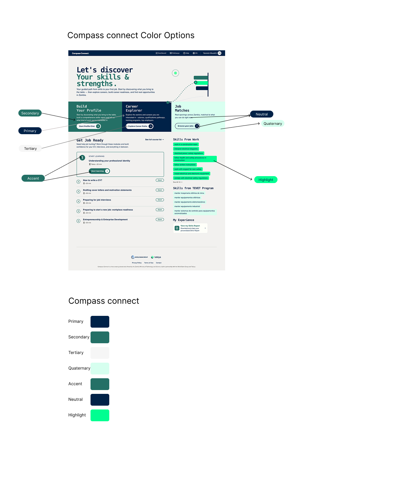

# Branding

Make the deployment look like your programme: its name, logos, images, colors and legal documents.

## Name and Country

| Setting | `.env` variable | What it is |
|---|---|---|
| `branding.appName` | `GLOBAL_PRODUCT_NAME` | name shown throughout the application (`{{appName}}` in texts) |
| `branding.country` | `GLOBAL_COUNTRY_NAME` | country named in texts, e.g. "opportunities in Zambia" (`{{country}}`); "your country" when unset |
| `branding.browserTabTitle` | `FRONTEND_BROWSER_TAB_TITLE` | text in the browser tab |

To change texts beyond these two names, use [text overrides](texts.md).

## SEO

| Setting | `.env` variable | What it is |
|---|---|---|
| `branding.metaDescription` | `FRONTEND_META_DESCRIPTION` | search engine description |
| `branding.seo` | `FRONTEND_SEO` | object with `name` (site name), `url` (public URL), `image` (social sharing image) and `description` |

## Logos and Icons

Put the files in `frontend-new/public/` and reference them as `/filename.ext`, or use the full URL of a hosted file.

| Setting | `.env` variable | What it is |
|---|---|---|
| `branding.assets.logo` | `FRONTEND_LOGO_URL` | main logo |
| `branding.assets.darkLogo` | `FRONTEND_DARK_LOGO_URL` | logo variant used on light backgrounds |
| `branding.assets.favicon` | `FRONTEND_FAVICON_URL` | browser tab icon |
| `branding.assets.appIcon` | `FRONTEND_APP_ICON_URL` | app icon (mobile / PWA) |
| `branding.assets.chatAvatar` | `FRONTEND_CHAT_AVATAR_URL` | avatar of the AI assistant in the chat |
| `branding.partnerLogos` | `FRONTEND_PARTNER_LOGOS` | partner logos in the footer: a list of `src`, `alt` and optional `width` / `height` |

```bash
FRONTEND_PARTNER_LOGOS=[{"src":"https://www.example.org/logo.svg","alt":"Example Organization","height":40}]
```

## Illustrations

`branding.illustrations` (`FRONTEND_ILLUSTRATIONS`) is an object with the images of key pages. Each value is a path
(`"/image.ext"`), or an object with `src`, `width` and `height` to also set the display size.

| Key | Where |
|---|---|
| `loginHero` | large image on the login page |
| `loginFeature1`, `loginFeature2`, `loginFeature3` | the three feature images on the login page |
| `homeHero` | image on the home page |
| `homeHeroIllustrationPosition` | `center` or `edge`: alignment of the home image |
| `careerReadinessHero` | image on the Career Readiness page |
| `authShapesBackground` | background pattern of the sign-in pages |
| `dashboardShapesBackground` | background pattern of the dashboard |

## Colors and Fonts

`branding.theme` (`FRONTEND_THEME_CSS_VARIABLES`) is an object of colors and fonts. Colors are space-separated RGB
values, for example `"0 255 145"`, so the application can derive transparent variants.



The seven brand colors:

| Key | Where |
|---|---|
| `brand-primary` | primary buttons and key interactive elements |
| `brand-secondary` | section headers and feature cards |
| `brand-tertiary` | subtle backgrounds and lower-emphasis areas |
| `brand-quaternary` | specific card backgrounds |
| `brand-accent` | tag chips and inline highlights |
| `brand-neutral` | navigation bar |
| `brand-highlight` | skill tags and programme chips |

Each one has variants with the suffixes `-light`, `-dark` and `-contrast-text`. When only the main value is set, the
variants are derived from it.

The theme also takes:

- `nav-main-background`, `nav-main-text` — the main navigation
- `page-background`, with `-light`, `-dark` and `-contrast-text` — the page background
- `text-primary`, `text-secondary`, `text-accent` — text colors
- `font-heading`, `font-body` — CSS font families, for example `"\"Plus Jakarta Sans\", sans-serif"`

See [`config/default.json`](../../config/default.json) for a complete theme. After changing colors, check that text
contrast meets WCAG AA (4.5 : 1 for body text, 3 : 1 for large text), for example with the
[WebAIM Contrast Checker](https://webaim.org/resources/contrastchecker/).

## Legal Documents

The privacy policy and terms of use are chosen by `branding.appName` (case-insensitive). This needs a code change:

1. Add two Markdown files to `frontend-new/src/legal/documents/`: `privacy-policy-{product-slug}.md` and
   `terms-of-use-{product-slug}.md`.
2. Register them in `frontend-new/src/legal/legalDocumentLoader.ts`, under `documentsByProductName`.

Without a match, the application shows the default documents.

Apply the changes as described in [Applying Changes](applying-changes.md).
